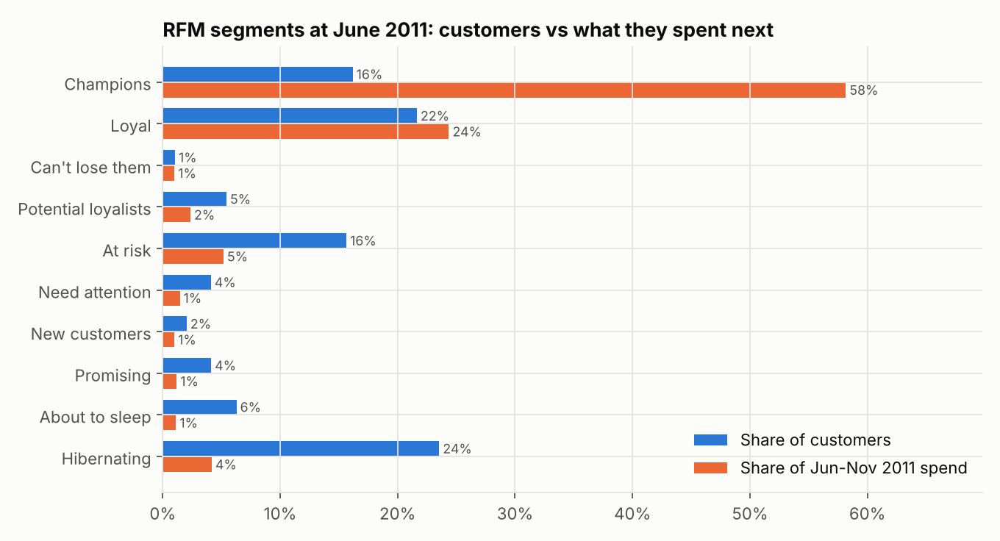
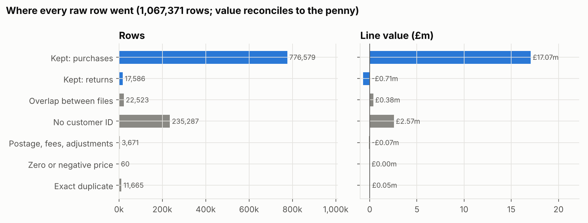
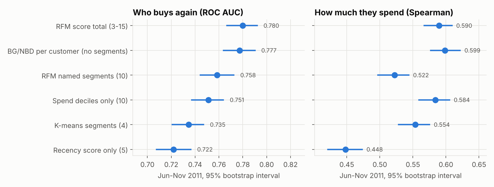
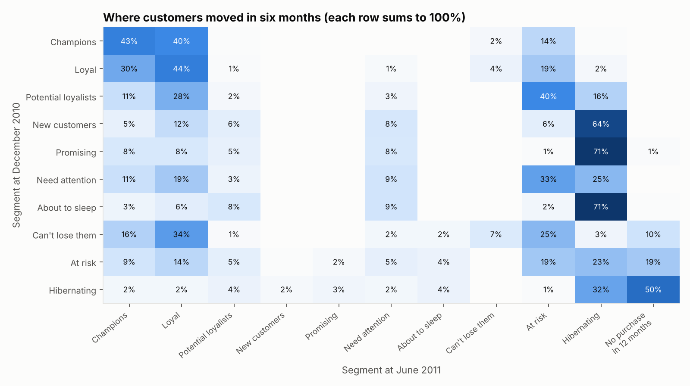
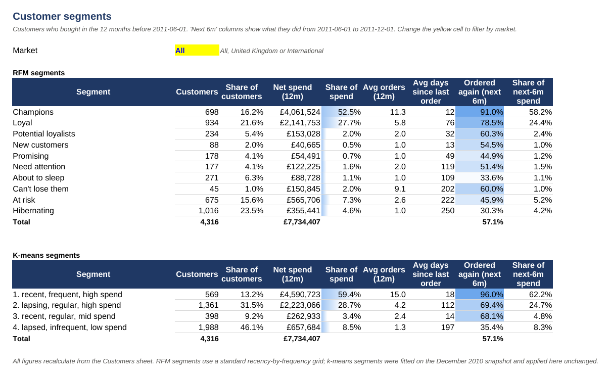
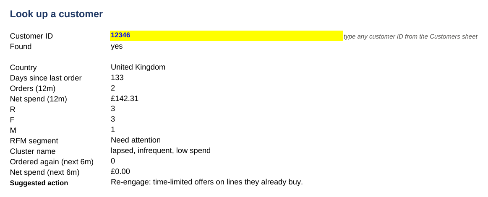
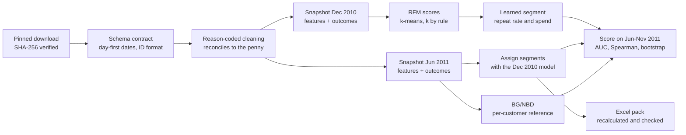

# Retail Customer Segmentation

**Which customers matter, which are slipping away, and do the segments actually predict what customers do next?**

[](https://github.com/gbadedata/retail-customer-segmentation/actions/workflows/ci.yml)


This project segments the customers of a UK online retailer and then tests the segments the way a business would rely on them: **built on one date, judged on what customers did afterwards**. The data is 1,067,371 invoice lines from UCI Online Retail II (December 2009 to December 2011). It starts with cleaning that reconciles every line to the penny, and ends with an Excel pack a marketing or account team can filter and look customers up in.

<p align="center"></p>

## Contents

- [Results at a glance](#results-at-a-glance)
- [Key findings](#key-findings)
- [What I would recommend](#what-i-would-recommend)
- [The Excel segment pack](#the-excel-segment-pack)
- [How it works](#how-it-works)
- [Mistakes this analysis is built to avoid](#mistakes-this-analysis-is-built-to-avoid)
- [Reproduce it](#reproduce-it)
- [Limitations](#limitations)
- [Data and licence](#data-and-licence)

## Results at a glance

The segments are built on the **December 2010** snapshot and applied unchanged at **June 2011** to 4,316 customers. They are then scored on purchases from **June to November 2011**.

| Question | Answer | Evidence |
|---|---|---|
| How concentrated is spend? | Top 10% of customers = **59.1%** of 12-month spend; top 20% = 73.0% | [Spend concentration](figures/07_spend_concentration.png) |
| Who carries the business? | Champions and Loyal: **37.8%** of customers, **82.5%** of next-period spend | Champions alone: 16.2% of customers, 58.2% of spend, 91% reordered |
| How many natural segments are there? | **4**, chosen by a rule fixed before seeing results | Bootstrap stability (ARI) 0.93; 7 or more segments were unstable |
| Do segments predict who buys again? | Yes. The simple **RFM total score is as good as a per-customer BG/NBD model** | ROC AUC 0.780 (0.767 to 0.792) vs 0.777 (0.764 to 0.790) |
| Where are customers lost? | At the **second order** | 64% of December's "New customers" had slipped to Hibernating by June |
| Can the raw data be trusted as-is? | No. **22,523 rows** (£377,488) are double-counted across the source files | All verified as exact copies; every line reconciles to £0.00 |

## Key findings

**1. The raw files double-count a week of trade.** The two yearly files overlap from 1 to 9 December 2010, and every overlapping row is an exact copy. The data also has no customer ID on 22% of rows (13.3% of value), writes dates day first, uses two different customer ID formats, and mixes postage, fees and write-offs in with sales. Each raw line gets one reason code, and the totals reconcile to the penny. ([data quality log](reports/DATA_QUALITY.md))

<p align="center"></p>

**2. Two segments carry the business.** Champions and Loyal customers produced 82.5% of next-period spend. Hibernating customers are 23.5% of the base but produced 4.2% of it.

**3. K-means picked four segments, and they are stable.** Candidates from 2 to 8 segments were compared on separation (silhouette, Davies-Bouldin, Calinski-Harabasz) and on bootstrap stability. Two segments separate best, but they are too coarse to act on. The rule (at least 3 segments, stability of at least 0.80, then best silhouette) selects 4. The top cluster, "recent, frequent, high spend", is 13.2% of customers and produced 62.2% of next-period spend, with 96% reordering. ([choosing k](figures/02_choosing_k.png), [profiles](figures/03_cluster_profiles.png))

**4. A simple score is as good as a sophisticated model.** Each segmentation's repeat rates and spend were learned on December 2010 outcomes, applied at June 2011, and scored against what customers actually did. The RFM total score matched a BG/NBD model that scores every customer individually. The ten named RFM segments do well on who reorders (AUC 0.758) but are the weakest on spend (Spearman 0.522), because the standard grid ignores spend entirely.

<p align="center"></p>

**5. The second order is where customers are lost.** Six months after December 2010, 64% of "New customers" and 71% of "Promising" customers had become Hibernating. Half of the December Hibernating customers had made no purchase in 12 months. Champions mostly stayed valuable: 43% were still Champions, 40% had moved to Loyal and 14% to At risk.

<p align="center"></p>

**6. Expected rates shift with the season, but the order of segments holds.** Repeat rates learned on December to May were lower than those observed for June to November in almost every segment, because the second window includes the pre-Christmas peak. The ranking of segments held. Use segments to set priorities, and recalibrate expected rates each season.

## What I would recommend

1. **Treat Champions and Loyal as accounts.** Protect service and give them a named contact. Measure any offer against a hold-out group, because 91% of Champions reorder within six months as things stand.
2. **Make a second-order programme the main retention effort**, because that is where most customers drop out.
3. **Don't pay to reactivate Hibernating customers without a test.** 30% reorder within six months as things stand, and the segment produces 4% of next-period spend.
4. **Rank customers on the RFM total score**, and use the named segments to talk about customers across the team.

## The Excel segment pack

[`outputs/customer_segments_pack.xlsx`](outputs/customer_segments_pack.xlsx) is built by the pipeline and recalculated in LibreOffice.

<p align="center"></p>

- **Segment_Summary:** RFM and k-means tables showing customers, share, net spend, share of spend, average orders, average days since the last order, next-period repeat rate and share of next-period spend. All are calculated with `COUNTIFS`, `SUMIFS` and `AVERAGEIFS`. A market dropdown (All, United Kingdom or International) filters every figure; International works through a `<>United Kingdom` criterion.
- **Customer_Lookup:** type a customer ID to see their scores, segment, what they did next and the suggested action, all through `INDEX`/`MATCH`.
- **Actions, Migration, Validation:** the playbook, the transition matrix and the validation table.
- **Cleaning_Log:** every rule with its row count and value, plus formula checks that rows and value balance.

<p align="center"></p>

The workbook has 134 formulas and zero errors. A test recalculates it under two market settings and checks the results against pandas.

## How it works



| Step | Method |
|---|---|
| Cleaning | Each row gets one reason code from the first rule it breaks: overlap copy, no customer ID, non-product line, bad price, bad quantity, exact duplicate. Cancellations from known customers are kept as returns and netted against spend. The pipeline fails if rows or value don't reconcile. |
| Features | For the 12 months before each snapshot: days since last order, number of orders, and net spend after returns. Outcomes are orders and net spend in the following six months. |
| RFM | Scores of 1 to 5 from percentile ranks with ties averaged, so identical customers always get the same score. Named segments follow a standard recency-by-frequency grid. |
| K-means | Log-transformed and standardised R, F and M. Candidates k = 2 to 8; 30-resample bootstrap ARI for stability; k chosen by the rule in [`config.py`](src/segments/config.py). Clusters are relabelled by spend and named from where their medians fall in the population. |
| Validation | Five segment schemes and one per-customer model are scored on ROC AUC (who reorders) and Spearman correlation (how much they spend), each with 95% intervals from 500 bootstrap resamples. |
| BG/NBD | Implemented from Fader, Hardie and Lee (2005) with SciPy. A test shows it reproduces the paper's CDNOW estimates (r = 0.243, alpha = 4.414, a = 0.793, b = 2.426, log-likelihood -9582.4) and its worked example (1.226 expected purchases). |

The full tables are in [reports/RESULTS.md](reports/RESULTS.md), which is generated by the pipeline.

## Mistakes this analysis is built to avoid

| Mistake | What it would do | What this repo does |
|---|---|---|
| Stacking the two yearly files | Double-counts £377,488 in the busiest week | Overlap detected, verified as exact copies, quarantined |
| Parsing dates month first | Swaps day and month for days 1 to 12 | Explicit day-first format; the contract fails the run otherwise |
| Ignoring returns | Overstates customer value | Returns netted against spend in the same window |
| Splitting tied customers between scores | Identical customers get different scores | Percentile ranks with ties averaged |
| Choosing k by eye from an elbow plot | Arbitrary, unrepeatable segments | Pre-declared rule with bootstrap stability |
| Judging segments on the data that built them | Flattering accuracy | Out of time: built on December 2010, scored on June to November 2011 |
| Trusting a hand-written statistical model | Silent maths errors | BG/NBD reproduces the published CDNOW estimates in a test |
| Losing revenue silently during cleaning | Totals that don't add up | Reconciliation asserted to the penny |
| Spreadsheet formulas that are silently wrong | Wrong numbers in front of a manager | Workbook recalculated and compared with pandas under two filters |

## Reproduce it

```bash
git clone https://github.com/gbadedata/retail-customer-segmentation
cd retail-customer-segmentation
make install   # pip install -e ".[dev]"
make data      # about 90 MB from a pinned mirror commit, SHA-256 verified
make run       # about 20 seconds: writes reports/, figures/, outputs/
make test      # 17 tests on synthetic data and the CDNOW fixture, no network needed
```

This needs Python 3.11 or later. LibreOffice (`soffice`) is optional: without it, the workbook is written but not recalculated. Seeds are fixed, and in testing a fresh clone reproduced the committed `reports/results.json` exactly.

| Output | What it is |
|---|---|
| [`reports/RESULTS.md`](reports/RESULTS.md) | Every table behind the findings |
| [`reports/DATA_QUALITY.md`](reports/DATA_QUALITY.md) | Nine findings, each with impact and handling |
| `reports/results.json` | Machine-readable results |
| `outputs/customer_segments_pack.xlsx` | Excel segment pack |
| `outputs/customer_segments_2011-06-01.csv` | One row per customer with scores, segment and cluster |
| `figures/` | Seven charts used above |

<details>
<summary>Repository layout</summary>

```
src/segments/
  config.py        snapshots, windows, k-selection rule, non-product codes
  download.py      pinned download with checksum verification
  load.py          schema contract (day-first dates, ID format, numeric checks)
  clean.py         reason-coded cleaning and reconciliation
  features.py      snapshot features and next-period outcomes
  rfm.py           scores, named segments, action playbook
  cluster.py       k selection with stability, k-means, naming
  bgnbd.py         BG/NBD from the paper
  validate.py      out-of-time evaluation, bootstrap, migration
  excel_pack.py    formula-driven segment workbook
  recalc.py        LibreOffice recalculation and formula error check
  figures.py       charts
  report.py        results.json and generated markdown
  pipeline.py      end-to-end run
tests/             synthetic transactions and the CDNOW fixture
scripts/           README preview renderer
```
</details>

<details>
<summary>What the tests cover</summary>

- **Contract:** day-first dates are parsed and month-first dates rejected, and the ID format is normalised. Missing columns stop the run, and files with a byte-order mark load correctly.
- **Cleaning:** every row lands in exactly one bucket, the first rule wins, value reconciles, and overlap copies are verified.
- **Features:** snapshot boundaries (a purchase on the snapshot day counts as an outcome, not a feature), returns are netted, non-positive customers are excluded, and BG/NBD inputs are consistent.
- **RFM:** tied customers get the same score, and the grid covers all 25 recency-frequency codes exactly once.
- **K-means:** clear three-group structure is recovered with stability above 0.95, and labels are ordered by spend.
- **BG/NBD:** the published CDNOW parameters, log-likelihood and worked example are reproduced.
- **Workbook:** structure checks, and formula results match pandas for "All" and "International".
</details>

## Limitations

- **Identified customers only.** 22% of rows (13.3% of value) have no customer ID and can't be segmented.
- **One fit-and-test pair.** A second test window would strengthen the conclusions, especially given the seasonal shift.
- **A mostly wholesale base.** Many customers are businesses, so a consumer retailer may see different concentration and segment behaviour.
- **The actions are a playbook to test.** Their effect needs measuring against hold-out groups.
- **A judgement on duplicates.** Exact duplicate lines (£53,302) are treated as double-keyed, but some may be genuine.
- **The BG/NBD spend score is a proxy.** It multiplies expected purchases by each customer's historical average order value, rather than fitting a separate spend model.

## Data and licence

Chen, D. (2012). *Online Retail II* [Dataset]. UCI Machine Learning Repository. [doi:10.24432/C5CG6D](https://doi.org/10.24432/C5CG6D). CC BY 4.0. Both sheets are downloaded at run time as CSV from a pinned commit of a public GitHub mirror and checked against the SHA-256 hashes in [`data/sources.json`](data/sources.json). The combined row count (1,067,371) matches UCI. No retail data is stored in this repository.

The CDNOW summary used as a test fixture comes from Fader, Hardie and Lee (2005), "Counting Your Customers the Easy Way", *Marketing Science* 24(2), as distributed with the `lifetimes` package (MIT).

The code is MIT licensed.

---

Built by **Oluwagbade Odimayo**, data scientist: [gbadedata.com](https://gbadedata.com) · [GitHub](https://github.com/gbadedata) · [LinkedIn](https://www.linkedin.com/in/oluwagbade-odimayo-)
